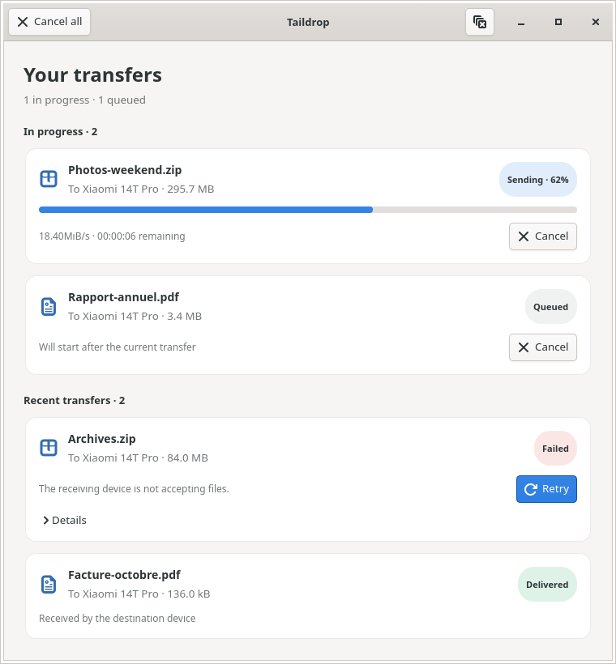
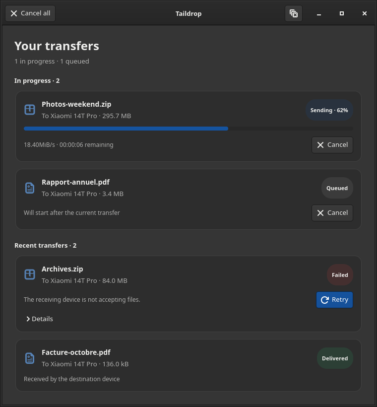
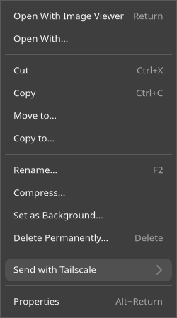
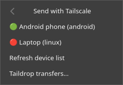
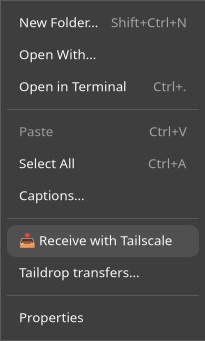
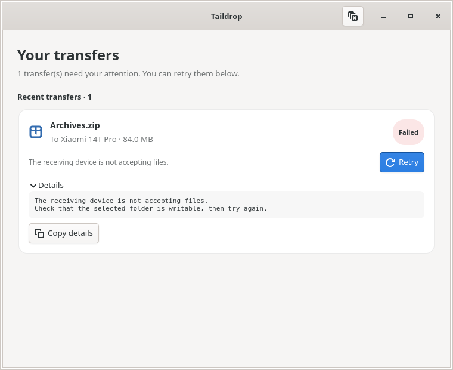
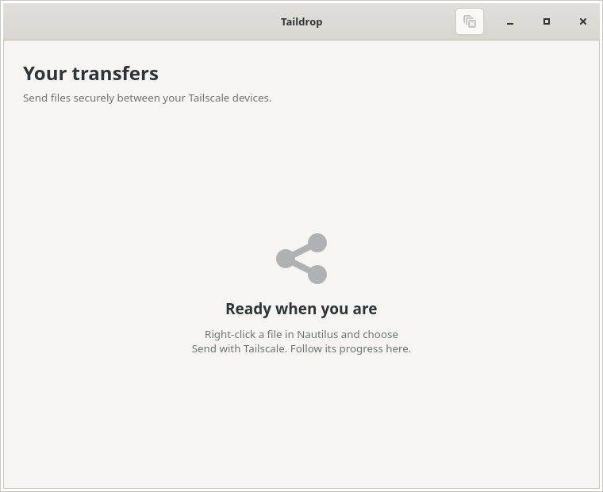

# Nautilus Taildrop

Send files to your own Tailscale devices directly from **Files (Nautilus)**,
receive incoming files into the folder you choose, and follow every operation
in a dedicated transfer window.

Built on [Tailscale Taildrop](https://tailscale.com/docs/features/taildrop).
No terminal is needed for everyday transfers.

[Installation](#installation) · [Sending](#send-files) · [Receiving](#receive-files) ·
[Transfer controls](#follow-and-manage-transfers) · [Troubleshooting](#troubleshooting)

| Light theme | Dark theme |
| --- | --- |
|  |  |

*Screenshots use example files, devices and transfer states. The window follows
your desktop's light or dark theme.*

## What you can do

- **Send one or several files** to devices belonging to your Tailscale account.
- **Receive pending files** into the local folder open in Nautilus.
- **See each file's progress**, size, destination and result.
- **Cancel, retry and inspect errors** without losing track of other files.
- **Refresh devices** from the context menu, including when the list is empty.
- **Keep transfers running** when the monitor is hidden or Nautilus restarts.

## Requirements

- Linux with Nautilus and its Python extension bindings (Nautilus 3 and 4 are supported).
- Python 3 with GObject bindings and GTK 4; GTK 3 is supported as a fallback.
- Tailscale installed and connected on both devices, using the same account.
- Taildrop enabled for your tailnet. See [Tailscale's setup instructions](https://tailscale.com/docs/features/taildrop#enable-taildrop-for-your-network).

Install the Nautilus bindings for your distribution:

| Distribution | Command |
| --- | --- |
| Ubuntu / Debian | `sudo apt install python3-nautilus python3-gi gir1.2-gtk-4.0` |
| Fedora | `sudo dnf install nautilus-python` |
| Arch Linux | `sudo pacman -S python-nautilus` |

On Fedora and Arch, also make sure GTK and the Python GObject bindings are
available. Desktop notifications use `notify-send` when installed; the transfer
window works without it.

If file operations report a permissions error, configure your user as a
Tailscale operator so transfers can run without root:

```bash
sudo tailscale set --operator="$USER"
```

## Installation

From the project directory:

```bash
make install
make restart
```

Reopen Nautilus after restarting it. The extension adds its entries to the
file and folder-background context menus.

Or install the extension manually:

```bash
mkdir -p ~/.local/share/nautilus-python/extensions/
cp taildrop.py ~/.local/share/nautilus-python/extensions/
nautilus -q
```

## Send files

1. Select a local image, document, archive or several files in Nautilus.
2. Right-click and open **Send with Tailscale**.
3. Choose the destination device. The transfer window opens and queues each file.

| Right-click a local image | Open **Send with Tailscale** |
| --- | --- |
|  |  |

The Taildrop submenu contains:

| Entry | What it does |
| --- | --- |
| **🟢 Device name (OS)** | Send the selected files to a device Tailscale reports as online. |
| **🔴 Device name (OS)** | Try sending to a device reported offline. It remains selectable because its reported status can lag behind reality. |
| **Refresh device list** | Start a new device lookup in the background. A loading entry appears while it runs; Nautilus is notified when the result is ready. The action is disabled while a lookup is already running. |
| **Taildrop transfers…** | Open or bring back the transfer window without starting another send. |

Only devices owned by your account are listed. Targets use their Tailscale IP
when available, so sending does not depend on local MagicDNS resolution. The
refresh and monitor entries remain available when no devices are found or
Tailscale is disconnected.

**Files must be local.** Copy files from `smb://`, `sftp://` or other remote
locations to your computer first. Taildrop does not send folders directly:
compress a folder into an archive before sending it.

## Receive files

1. Open the local folder where you want to save incoming Taildrop files.
2. Right-click **empty space inside the folder**, rather than a file.
3. Choose **📥 Receive with Tailscale**.



| Entry | What it does |
| --- | --- |
| **📥 Receive with Tailscale** | Retrieve files waiting in the local Tailscale inbox and save them into this folder. |
| **Taildrop transfers…** | Open the transfer window to inspect sends, receives and recent results. |

Receiving checks the inbox once; it does not enable continuous background
reception. If the inbox is empty, the monitor reports an inbox check. If a
filename already exists, the incoming file is renamed to preserve the existing
file. The receive entry is available only for local folders.

Nautilus also shows its usual actions, such as Open With, Copy, Select All and
Properties. Those entries depend on your Nautilus version and other extensions;
the tables above describe the options added by Taildrop.

## Follow and manage transfers

Each file has a card with its name, size and destination. Active and queued
operations appear under **In progress**; finished operations move to **Recent
transfers**, with the newest results first. A receive operation represents one
inbox check into the selected folder.

| Control | Availability and behavior |
| --- | --- |
| **Cancel** | Stop one active operation or remove a queued operation before it starts. |
| **Cancel all** | Stop all active and queued operations. This toolbar button appears while work is pending. |
| **Retry** | Queue another attempt for a failed or cancelled operation. Other queued files keep their place. |
| **Details** | Expand status and error details for a failed, cancelled or stalled operation. |
| **Copy details** | Copy those details to the clipboard; available inside **Details**. |
| **Clear finished transfers** | The clear-history icon in the top-right toolbar removes completed, failed and cancelled cards. Active and queued operations are kept. Hover over the icon to see its label. |
| **Close window** | Hide the monitor while transfers continue. Reopen it using **Taildrop transfers…** from either context menu. |



### Understanding the status

| Status | Meaning |
| --- | --- |
| **Queued** | Waiting for the current operation to finish. Operations run one at a time. |
| **Sending / Receiving** | The command is running. Sending shows a percentage and speed/remaining time when Tailscale provides them; otherwise the progress bar is indeterminate. |
| **Waiting for device** | No progress has been reported for 30 seconds. Check the receiver, keep waiting, or cancel. This is a warning, not an automatic failure. |
| **Cancelling** | The command is being stopped. If it does not exit normally, it is forcibly stopped after two seconds. |
| **Delivered** | Tailscale has acknowledged delivery of that file to the destination device. |
| **Inbox checked** | The receive command finished. The details indicate its result, including an empty inbox. |
| **Failed** | The operation ended with an error. Read **Details**, address the cause and use **Retry**. |
| **Cancelled** | The operation was stopped or cancelled before starting. Files already delivered remain on the receiver. |

There is no size-based deadline that aborts a slow transfer. A failed file does
not prevent the remaining selected files from being attempted. Repeated clicks
on the same file and destination do not duplicate an active or queued transfer.
Retrying a file that was already delivered can produce another copy.

The monitor runs separately from Nautilus, so restarting the file manager does
not interrupt its transfers. History is kept in memory for the monitor's
lifetime; it is not a permanent transfer log.

<details>
<summary>What the monitor looks like before the first transfer</summary>



</details>

You can also open the monitor directly from the project directory:

```bash
/usr/bin/python3 taildrop.py --transfers
```

## Troubleshooting

| Symptom | What to check |
| --- | --- |
| No Taildrop menu | Confirm the Nautilus Python bindings are installed, run `make install`, quit Nautilus and reopen it. |
| Missing devices or an empty list | Use **Refresh device list**. Check that Tailscale is connected and both devices belong to the same account. |
| A device is green but a transfer stalls | Online status indicates network presence, not that file reception is ready. Check the receiving app and its folder permissions. A successful `tailscale ping DEVICE` alone does not prove the file receiver is ready. |
| A transfer fails | Expand **Details** and use **Copy details** to get the exact error. Check Taildrop availability, receiver access and local Tailscale operator permissions. |
| A folder or network file will not send | Compress folders first and copy remote files locally before sending. |
| Receive finds nothing | Confirm the sender delivered the file to this computer. Receive checks the pending inbox once and saves into the folder where you invoked it. |

### Android: stuck at 0% with no visible error

The Android receiver can wait for access to its destination folder even when
the app shows no error. In Tailscale on the phone:

1. Open **Settings → Permissions → Taildrop directory access**.
2. Choose a writable local folder again, such as a dedicated **Taildrop** folder.
3. Approve **Use this folder**, then retry the transfer.

The Android receiver [waits for a writable folder before opening an incoming
file](https://github.com/tailscale/tailscale-android/blob/main/android/src/main/java/com/tailscale/ipn/util/ShareFileHelper.kt).

## Development and tests

Run the regression suite:

```bash
make test
```

To exercise the GTK window and command forwarding between two application
processes in an isolated desktop session (requires `dbus-run-session` and
`xvfb-run`):

```bash
dbus-run-session -- xvfb-run -a /usr/bin/python3 tests/monitor_smoke.py
```

Tests use a fake CLI and pseudo-terminal for progress, cancellation (including
an unresponsive process), errors, inbox retrieval and device refresh. They do
not send files over Tailscale. Nautilus Python bindings and Python GObject are
required.

Documentation screenshots are stored in [`images/`](images/). The context menus
were captured from Nautilus with example devices; the transfer-window images
use simulated states rather than real in-flight transfers.

An [earlier video demo](https://www.youtube.com/watch?v=KXvxQX_CKx4) is also
available; its interface predates the current transfer monitor.

## Uninstallation

```bash
make uninstall
make restart
```

## License

[MIT](LICENSE)
